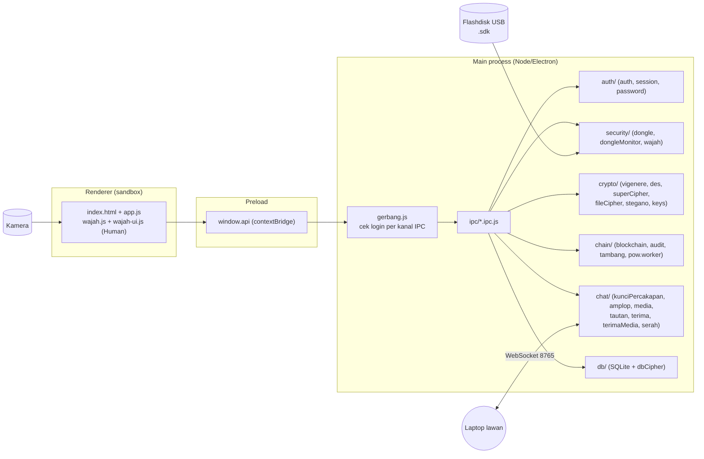
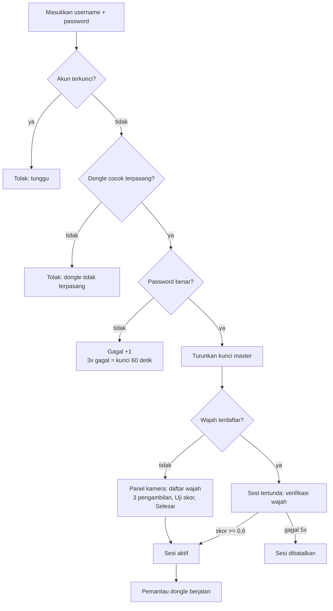
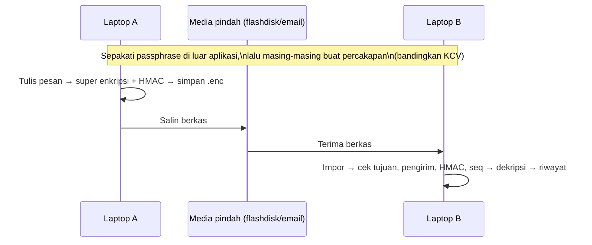

# Sandikarya (TA-Kriptoasik)

**Sandikarya** (sandi + karya) adalah aplikasi desktop kriptografi untuk Tugas Akhir Kriptografi, dibangun dengan **JavaScript + Electron**. Studi kasusnya: **distribusi aset digital kreatif antar studio** (model 3D, tekstur, naskah, dan desain yang belum dirilis dipertukarkan antar dua studio dengan aman). Satu aplikasi yang menggabungkan:

- **Autentikasi berlapis**: dongle flashdisk USB + password + biometrik wajah
- **Super enkripsi teks**: Vigenère (mod 26) lalu DES mode CBC
- **Enkripsi file**: AES-256-GCM (format `.enc`)
- **Enkripsi basis data**: ChaCha20-Poly1305
- **Steganografi gambar**: LSB acak; gambar sampul boleh PNG atau JPEG, hasil selalu PNG; isi pesan dienkripsi AES-256-GCM
- **Blockchain sederhana**: registri kepemilikan aset dengan **serah terima dua pihak** (TRANSFER + TERIMA) dan **periksa silang** antar laptop, serta **log audit** kejadian aplikasi yang tahan ubah (tamper-evident), dengan Proof of Work
- **Komunikasi dua arah antar dua laptop**: **sambungan langsung** lewat jaringan (WebSocket, port 8765) untuk pesan, berkas `.enc`, gambar stego, dan serah terima aset; atau pertukaran berkas manual (`.enc`, `.png`) sebagai cadangan. Keduanya memakai passphrase bersama.

> **Catatan platform:** harus dijalankan sebagai **aplikasi desktop (Electron)**, bukan di browser. Browser tidak bisa membaca serial number flashdisk dan tidak bisa mendeteksi pencabutannya. Deteksi dongle saat ini memakai **PowerShell, jadi hanya berjalan di Windows**.

---

## Daftar Isi

1. [Keputusan Rancangan](#1-keputusan-rancangan)
2. [Arsitektur](#2-arsitektur)
3. [Struktur Repositori](#3-struktur-repositori)
4. [Alur Autentikasi dan Hierarki Kunci](#4-alur-autentikasi-dan-hierarki-kunci)
5. [Algoritma yang Digunakan](#5-algoritma-yang-digunakan)
6. [Skema Basis Data](#6-skema-basis-data)
7. [Komunikasi Dua Laptop](#7-komunikasi-dua-laptop)
8. [Prasyarat](#8-prasyarat)
9. [Clone dan Menjalankan Program](#9-clone-dan-menjalankan-program)
10. [Panduan Penggunaan](#10-panduan-penggunaan)
11. [Menjalankan Pengujian](#11-menjalankan-pengujian)
12. [Skrip Bantu (`tools/`)](#12-skrip-bantu-tools)
13. [Catatan Keamanan dan Batasan](#13-catatan-keamanan-dan-batasan)

---

## 1. Keputusan Rancangan

| Aspek | Keputusan |
|---|---|
| Bahasa / platform | JavaScript dengan Electron |
| Super enkripsi teks | Vigenère (**mod 26**) lalu **DES** mode CBC (menggantikan DES) |
| Kesepakatan kunci antar laptop | **Passphrase bersama** (disepakati di luar aplikasi), karena algoritma klasik tidak asimetris |
| Autentikasi | 3 faktor: dongle USB, password, wajah (**didaftarkan saat membuat akun**, wajib untuk semua akun) |
| Penyimpanan | SQLite bawaan Node (`node:sqlite`), seluruh data sensitif terenkripsi |
| Blockchain | Satu rantai untuk dua tujuan: registri aset (REGISTER, TRANSFER, TERIMA) dan **log audit** (blok `AUDIT`) |
| Format berkas | **`.enc`** untuk pesan dan berkas terenkripsi (dibedakan oleh isinya), **`.sdk`** untuk kunci dongle, `.png` untuk gambar stego |
| Transport antar laptop | **Sambungan langsung** (WebSocket `ws`, port 8765, satu sambungan pada satu waktu) dan, sebagai cadangan, **berkas** yang dipindahkan manual (flashdisk, email, dsb.) |

### Studi kasus: distribusi aset kreatif antar studio

Dua studio kreatif bertukar aset yang belum dirilis di laptop yang sering dibawa keluar kantor. Kebutuhannya dan jawabannya:

| Kebutuhan | Fitur |
|---|---|
| Hanya staf sah yang masuk; laptop yang ditinggal tidak boleh terbuka | Login tiga faktor; flashdisk dicabut, sesi langsung terkunci |
| Pesan koordinasi tidak terbaca pihak ketiga | Super enkripsi Vigenère + DES, amplop ber-MAC |
| Berkas aset besar harus utuh dan rahasia | AES-256-GCM (`.enc`) |
| Catatan penting (lisensi, kesepakatan) aman di laptop | ChaCha20-Poly1305 di basis data |
| Bukti siapa memegang hak atas aset dan kapan berpindah | Blockchain: registri aset, serah terima dua pihak, periksa silang dengan laptop lawan |
| Jejak siapa mengakses aplikasi | Log audit pada rantai yang sama; perubahan catatan lama terdeteksi |

Blockchain dipakai untuk membuktikan **urutan dan keutuhan catatan**, bukan untuk kerahasiaan (itu tugas enkripsi).

Pemisahan hak akses di Electron: proses utama (`main`) memegang semua kunci dan operasi kripto; tampilan (`renderer`) berjalan dengan `contextIsolation: true`, `nodeIntegration: false`, `sandbox: true`, dan hanya bisa memanggil fungsi yang diekspos `preload.js` lewat `window.api`.

---

## 2. Arsitektur



Setiap kanal IPC (kecuali `app:ping`, `auth:status`, `auth:daftar`, `auth:masuk`, `auth:keluar`, `auth:wajah`, `auth:daftarWajah`, `auth:ujiWajah`, `auth:selesaiDaftarWajah`, `auth:batalDaftar`, `dongle:status`) dibungkus `gerbang.js` sehingga **ditolak bila belum login penuh**. Gerbang yang sama **mencatat kejadian ke log audit** (login, pesan, berkas, dan sebagainya) setelah kanal selesai, sehingga tidak ada fitur yang lupa mencatat.

---

## 3. Struktur Repositori

```
TA-Kriptoasik/
├── package.json            # skrip: start, test, test:watch
├── vitest.config.mjs       # konfigurasi pengujian (tests/**/*.test.js)
├── ALUR_PENGERJAAN.md      # catatan alur pengerjaan
├── RANCANGAN.md            # rancangan teknis lengkap
├── COMMIT_HISTORY.md       # riwayat commit
├── src/
│   ├── main/               # proses utama Electron
│   │   ├── main.js         # titik masuk, BrowserWindow, izin kamera, --data-dir
│   │   ├── auth/
│   │   │   ├── auth.js         # daftar akun, login, lockout, turunkan kunci master
│   │   │   ├── session.js      # sesi di memori, kunci master, subkunci HMAC
│   │   │   └── password.js     # hash password PBKDF2
│   │   ├── security/
│   │   │   ├── dongle.js        # deteksi flashdisk (PowerShell), .sdk, tag HMAC
│   │   │   ├── dongleMonitor.js # pemantau pencabutan dongle
│   │   │   ├── wajah.js         # pendaftaran saat buat akun, templat terenkripsi, pencocokan
│   │   │   └── protokolModel.js # protokol svmodel:// untuk model Human
│   │   ├── crypto/
│   │   │   ├── vigenere.js     # Vigenère mod 26
│   │   │   ├── des.js          # DES 16 putaran + mode CBC (PKCS#7)
│   │   │   ├── superCipher.js  # Vigenère -> DES CBC -> Base64
│   │   │   ├── fileCipher.js   # AES-256-GCM, format .enc
│   │   │   ├── stegano.js      # LSB acak; sampul PNG/JPEG, keluaran PNG
│   │   │   └── keys.js         # PBKDF2-HMAC-SHA256 (200.000 iterasi)
│   │   ├── chain/
│   │   │   ├── blockchain.js   # blok, hash, validasi, aturan transaksi (REGISTER/TRANSFER/TERIMA), AUDIT
│   │   │   ├── audit.js        # pencatatan log audit (antrean, tidak pernah melempar galat)
│   │   │   ├── tambang.js      # penambangan di worker thread
│   │   │   └── pow.worker.js   # pencarian nonce
│   │   ├── chat/
│   │   │   ├── kunciPercakapan.js # kunci percakapan dari passphrase bersama
│   │   │   ├── amplop.js          # amplop pesan .enc + HMAC
│   │   │   ├── media.js           # pembungkus berkas/gambar untuk kontak
│   │   │   ├── tautan.js          # sambungan langsung WebSocket (dengarkan/sambung/kirim)
│   │   │   ├── terima.js          # verifikasi + dekripsi amplop (dipakai impor berkas dan sambungan)
│   │   │   ├── terimaMedia.js     # simpan berkas/gambar yang diterima
│   │   │   └── serah.js           # bukti serah terima aset (MAC) dan periksa silang
│   │   ├── db/
│   │   │   ├── db.js           # skema SQLite
│   │   │   ├── dbCipher.js     # ChaCha20-Poly1305
│   │   │   ├── percakapan.js   # percakapan dan riwayat pesan
│   │   │   └── pesanPenting.js # arsip pesan penting
│   │   └── ipc/                # penangan kanal IPC per fitur + gerbang.js
│   │                           #   (jaringan.ipc.js: sambungan langsung, serah terima)
│   ├── preload/preload.js  # jembatan aman: window.api
│   └── renderer/           # tampilan (index.html, app.js, styles/app.css,
│                           #   wajah.js, wajah-ui.js)
├── tests/                  # pengujian Vitest per modul
└── tools/                  # skrip eksperimen (USB, WebSocket)
```

---

## 4. Alur Autentikasi dan Hierarki Kunci

### 4.1 Alur login



Pembuatan akun memakai alur yang sama: setelah username, password, dan flashdisk diterima, akun baru langsung diminta mendaftarkan wajah. Kegagalan dongle tidak dihitung sebagai salah password. Saat sesi berjalan, `dongleMonitor` memeriksa berkas `.sdk` **tiap 1 detik** dan serial flashdisk **tiap 10 detik**. Bila dongle dicabut, kunci dan sesi dihapus dari memori dan tampilan kembali ke layar login.

### 4.2 Hierarki kunci

```
password  ─┐
           ├─ "password \0 secret_hex" ──PBKDF2(200.000, kdf_salt)──► KUNCI MASTER (32 byte, hanya di memori)
secret .sdk (di flashdisk) ─┘                                          │
                                                                         ├─ HMAC("db")    → k_db   (ChaCha20-Poly1305 untuk isi basis data)
                                                                         └─ HMAC("wajah") → k_wajah (AES-256-GCM untuk templat wajah)
```

Karena `secret` ikut menurunkan kunci master, **data lokal tidak bisa dibuka tanpa flashdisk dongle**, walaupun password diketahui.

---

## 5. Algoritma yang Digunakan

### 5.1 Vigenère (mod 26) — `crypto/vigenere.js`

- Hanya huruf A–Z/a–z yang diubah; huruf besar/kecil dipertahankan, karakter lain dibiarkan.
- Kunci hanya huruf; posisi kunci maju **hanya saat menemui huruf**.
- Enkripsi: `C = (P + K) mod 26`, dekripsi: `P = (C − K) mod 26` (dengan `mod` yang selalu positif).

### 5.2 DES (Data Encryption Standard) — `crypto/des.js`

- Ditulis sendiri sesuai FIPS 46-3: blok 64 bit, kunci 64 bit (56 bit efektif), **16 putaran Feistel**, delapan S-box.
- **Pembangkit subkunci:** `PC1` → pisah 28|28 → geser kiri sesuai jadwal → `PC2` = 16 subkunci 48 bit.
- **Enkripsi blok:** `IP → 16 putaran (F: E → XOR subkunci → S-box → P) → tukar → FP`.
- **Dekripsi blok:** sama, dengan urutan subkunci dibalik.
- **Mode CBC** dengan padding **PKCS#7**: `C[i] = E(P[i] XOR C[i−1])`, `C[0] = IV` (8 byte acak).
- Divalidasi dengan **vektor baku FIPS** (kunci `133457799BBCDFF1`, blok `0123456789ABCDEF` menghasilkan `85E813540F0AB405`) dan dibandingkan dengan OpenSSL.
- Kunci berupa 16 karakter heksadesimal.

### 5.3 Super enkripsi teks — `crypto/superCipher.js`

```
Enkripsi: teks → Vigenère → UTF-8 → DES CBC (IV acak 8 byte) → Base64( IV || ciphertext )
Dekripsi: Base64 → pisah IV → DES CBC dekripsi → UTF-8 → Vigenère dekripsi
```

Kunci: Vigenère (huruf A–Z) dan DES (16 karakter heksadesimal). Hasil juga mengembalikan `rincian` tiap tahap untuk ditampilkan di UI.

### 5.4 Enkripsi file — `crypto/fileCipher.js`

- Kunci: **PBKDF2-HMAC-SHA256**, 200.000 iterasi, salt 16 byte acak, keluaran 256 bit (passphrase minimal 8 karakter).
- Cipher: **AES-256-GCM**, IV 12 byte.
- Format berkas `.enc`:

```
"SKRY1" (5) | salt (16) | iv (12) | tag (16) | ciphertext
ciphertext = AES-GCM( panjangNama (2 byte) | nama berkas asli | isi berkas )
```

`MAGIC + salt + iv` ikut diautentikasi sebagai AAD, sehingga header yang diubah ditolak. Ukuran maksimal 200 MB.

### 5.5 Enkripsi basis data — `db/dbCipher.js`

- **ChaCha20-Poly1305** (RFC 8439) lewat pustaka `@noble/ciphers` (BoringSSL milik Electron tidak menyediakannya via `crypto.createCipheriv`).
- Format: `nonce (12) | ciphertext | tag (16)`; AAD mengikat konteks (mis. `pesan-penting:<userId>`, `chat-pesan:<percakapanId>`), sehingga blob tidak bisa dipindah antar baris/pengguna.

### 5.6 Steganografi gambar — `crypto/stegano.js`

- Media: gambar sampul **PNG atau JPEG**, penyisipan pada **LSB kanal R, G, B** (alpha tidak disentuh). JPEG didekode ke piksel mentah (`jpeg-js`) lalu disisipi; **hasil selalu PNG**. Pengambilan pesan hanya dari PNG hasil sisip, karena kompresi JPEG (lossy) akan menghancurkan bit tersembunyi; berkas JPEG ditolak dengan pesan yang jelas.
- Pesan dienkripsi dulu dengan **AES-256-GCM** (kunci dari passphrase via PBKDF2).
- **Header 48 byte** di posisi berurutan: `salt (16) | iv (12) | tag (16) | panjang (4)`.
- **Isi ciphertext** disebar ke **posisi acak tanpa pengulangan** (Fisher-Yates sebagian, bilangan acak dari HMAC-SHA256 dengan penghitung, kunci diturunkan dari passphrase). Tanpa passphrase yang benar, posisi bit tidak bisa diketahui.
- Kualitas gambar dihitung dengan **PSNR** (untuk sampul JPEG, dibandingkan dengan piksel hasil dekode); kapasitas = `(piksel × 3 − 384) / 8` byte.

### 5.7 Blockchain sederhana: registri aset dan log audit — `chain/`

- Blok: `{ index, waktu, hashSebelumnya, data, nonce, hash }`.
- `hash = SHA-256( index | waktu | hashSebelumnya | JSON-stabil(data) | nonce )`; JSON diurutkan kuncinya agar hash deterministik.
- **Proof of Work:** hash harus diawali `000` (kesulitan 3). Penambangan berjalan di **worker thread** agar UI tidak membeku.
- Blok **genesis** tetap, sama di semua laptop.
- Transaksi:
  - `REGISTER` — mendaftarkan aset (ID unik `[A-Za-z0-9_-]{1,40}`).
  - `TRANSFER` — hanya pemilik saat ini yang boleh memindahkan aset (ditulis pengirim).
  - `TERIMA` — dicatat penerima sebagai saksi serah terima, memuat hash blok TRANSFER pengirim; ditolak bila pemilik di rantai lokal bukan pihak `dari` (mencegah penjualan ganda).
- `validasiRantai` memeriksa genesis, urutan indeks, kecocokan hash, PoW, tautan `hashSebelumnya`, dan aturan transaksi, serta menunjuk **blok pertama yang rusak**.
- Rantai disimpan di `rantai.json` pada folder data aplikasi (berkas dibuat saat blok pertama ditulis).
- **Log audit** (`chain/audit.js`): kejadian penting dicatat sebagai blok `{ tipe: 'AUDIT', aksi, pelaku, rincian }` pada rantai yang sama. Contoh aksi: `LOGIN_BERHASIL`, `LOGIN_GAGAL`, `WAJAH_GAGAL`, `AKUN_DIBUAT`, `LOGOUT`, `DONGLE_DICABUT`, `PESAN_DIKIRIM`, `PESAN_DITERIMA`, `BERKAS_DIENKRIPSI`, `GAMBAR_DISISIPI`, `PESAN_PENTING_DIBUKA`. **Isi pesan, isi berkas, dan password tidak pernah dicatat.**
- Penambahan blok berjalan lewat **antrean** (kejadian bersamaan tidak saling menimpa). Bila rantai sedang rusak, blok baru ditolak; kegagalan mencatat tidak pernah mengganggu fitur yang dipakai.
- Halaman **Log Audit** menampilkan semua catatan dan status validasi. Tidak ada tombol Reset atau Palsukan: log bersifat **tamper-evident** (perubahan terdeteksi), bukan tamper-proof (tidak bisa diubah).
- **Serah terima aset** (halaman Aset, saat sambungan langsung aktif): pengirim menambang blok TRANSFER lalu mengirim bukti ber-MAC; penerima memverifikasi lalu menambang blok TERIMA. **Periksa silang** meminta blok TRANSFER dari laptop lawan dan membandingkannya dengan salinan lokal (status cocok, diubah, berbeda, atau hilang). Inilah bagian yang memberi nilai lebih dibanding rantai lokal biasa.
- **Batasan:** rantai disimpan lokal (`rantai.json`, JSON biasa) tanpa konsensus. Siapa pun dengan akses penuh ke laptop dapat menulis ulang seluruh rantai; perubahan sebagian terdeteksi oleh validasi, dan perbedaan dengan laptop lawan terdeteksi oleh periksa silang. Demo: cadangkan `rantai.json`, ubah satu nilai di Notepad, lalu tekan Validasi rantai.

### 5.8 Hash password — `auth/password.js`

PBKDF2-HMAC-SHA256, 210.000 iterasi, salt acak 16 byte, pembandingan `timingSafeEqual`. Username yang tidak ada tetap menjalankan hash agar waktu proses seragam.

### 5.9 Dongle USB — `security/dongle.js`

- Berkas `.sdk` di akar flashdisk berisi `secret` (32 byte acak).
- Basis data menyimpan `dongle_tag = HMAC-SHA256(kunci = secret, pesan = serial flashdisk)`.
- `.sdk` yang disalin ke flashdisk lain ditolak karena serial berbeda.
- Beberapa akun boleh memakai flashdisk yang sama (secret yang sudah ada dipakai ulang).

### 5.10 Pengenalan wajah — `security/wajah.js`, `renderer/wajah*.js`

- Pustaka **@vladmandic/human** di renderer menghasilkan **embedding 1024 angka**; model dilayani lewat protokol khusus `svmodel://`.
- **Pendaftaran saat membuat akun:** panel kamera muncul setelah username, password, dan flashdisk diterima. Ambil 3 pengambilan yang saling mirip, dirata-ratakan menjadi templat. Tombol **Uji skor** menampilkan skor terhadap ambang untuk kalibrasi, **daftar ulang** bila perlu, lalu **Selesai dan masuk**. **Batal** menghapus akun yang baru dibuat.
- Akun yang belum punya templat (misalnya data lama) diminta mendaftarkan wajah pada login berikutnya, sehingga semua akun wajib punya wajah.
- Pencocokan saat login: jarak kuadrat → skor kemiripan 0–1, **ambang 0,6**, maksimal 5 kegagalan.
- Templat disimpan **terenkripsi AES-256-GCM** dengan subkunci `wajah` dari kunci master.

---

## 6. Skema Basis Data

Berkas: `sandikarya.db` (SQLite) di folder data aplikasi.

| Tabel | Isi utama |
|---|---|
| `users` | username, hash password (salt, iterasi), `kdf_salt`, hitungan gagal + waktu kunci, `dongle_tag`, `wajah_embedding` (terenkripsi) |
| `pesan_penting` | arsip pesan penting per pengguna (`cipher` BLOB = label + isi, ChaCha20-Poly1305) |
| `percakapan` | kontak, `kcv`, kunci master percakapan terenkripsi (`kunci_enc`), nomor urut kirim/terima |
| `pesan` | riwayat pesan: arah (masuk/keluar), `seq`, waktu, `penting`, isi terenkripsi |

---

## 7. Komunikasi Dua Laptop

Ada dua jalur dengan kunci percakapan dan amplop yang sama: **sambungan langsung** (utama) dan **pertukaran berkas** (cadangan).

### 7.1 Kunci percakapan

Kedua pengguna menyepakati **satu passphrase** di luar aplikasi. Kunci master percakapan:

```
master = PBKDF2( passphrase, salt = SHA256("sandikarya-percakapan-v1|" + sort(userA, userB))[0..16] )
```

Karena salt berasal dari dua username yang diurutkan, **kedua laptop menurunkan kunci yang sama tanpa saling mengirim apa pun**. Subkunci (HMAC-SHA256 dari master):

| Subkunci | Kegunaan |
|---|---|
| `mac` | stempel keaslian pesan |
| `kcv` | kode cek kunci 6 digit hex untuk dibandingkan di kedua laptop |
| `vigenere` | 12 huruf A–Z |
| `des` | 64 bit (16 karakter heksadesimal) |
| `berkas` | passphrase pengganti untuk berkas `.enc` |
| `gambar` | passphrase pengganti untuk steganografi |

### 7.2 Pesan teks (`.enc`)

Pesan teks dan berkas sama-sama berekstensi `.enc`. Aplikasi membedakannya dari isi: pesan teks berupa JSON, berkas diawali penanda `SKRY1`. Bila salah memilih jenis, aplikasi menolak dengan petunjuk.

```json
{ "v": 1, "dari": "...", "ke": "...", "seq": 1, "waktu": 0, "id": "...", "token": "...", "mac": "..." }
```

- `token` = hasil super enkripsi (Vigenère → DES CBC → Base64).
- `mac` = **HMAC-SHA256** atas semua bidang lain (*encrypt-then-MAC*). Algoritma klasik tidak mendeteksi perubahan data, jadi MAC inilah yang menolak pesan yang diubah atau yang memakai passphrase salah, **sebelum** dekripsi dijalankan.
- `seq` harus lebih besar dari nomor terakhir yang diterima, sehingga **pesan lama atau yang diimpor ulang (replay) ditolak**.
- Pemeriksaan tambahan: penerima (`ke`) dan pengirim (`dari`) harus sesuai percakapan.

### 7.3 Berkas dan gambar untuk kontak

- Berkas: format `.enc` (AES-256-GCM) dengan kunci `kunci.berkas`.
- Gambar: pesan dienkripsi AES-256-GCM lalu disisipkan LSB dengan kunci `kunci.gambar`. Sampul boleh PNG atau JPEG; yang dikirim/disimpan selalu PNG.

### 7.4 Sambungan langsung (`chat/tautan.js`)

1. Laptop A: buka halaman Chat, tekan **Mulai menerima** (mendengarkan di port 8765).
2. Laptop B: isi alamat IP laptop A, tekan **Sambungkan**. Status kedua sisi menjadi *terhubung* setelah saling bertukar `halo` (nama pengguna). Batas waktu jabat tangan 5 detik.
3. Kirim lewat tombol **Kirim langsung**: pesan teks, **berkas `.enc`** (batas 12 MB), dan **gambar stego**. Penerima memverifikasi amplop (tujuan, pengirim, HMAC, seq) lalu mendekripsi. Berkas yang diterima disimpan otomatis ke `Downloads\Sandikarya\` tanpa menimpa berkas lain; pada gambar stego, pesan diekstrak dan dicatat.
4. Satu sambungan pada satu waktu. Sambungan putus otomatis saat logout atau dongle dicabut.

Syarat jaringan: kedua laptop satu jaringan dan profil jaringan Private; bila gagal, izinkan port 8765 di firewall Windows, atau pakai hotspot ponsel (beberapa Wi-Fi publik/kampus mengisolasi klien). Gangguan di aplikasi memberi galat dalam sekitar 6 detik, bukan menggantung.

Kanal sambungan menggunakan bingkai JSON: `halo`, `pesan`, `berkas`/`gambar` (Base64), `serah`/`periksa` dengan `jawab`, `ack`, dan `tolak`. Balasan ditunggu maksimal 30 detik. Sambungan **tidak** menggantikan keamanan amplop: isi tetap terenkripsi dan ber-MAC sehingga penyadap jaringan tidak membaca atau mengubahnya tanpa terdeteksi (sambungan sendiri tidak memakai TLS).

### 7.5 Alur (pertukaran berkas)



---

## 8. Prasyarat

- **Windows 10/11** (deteksi dongle memakai PowerShell; fitur lain relatif lintas platform, tetapi login memerlukan dongle)
- **Node.js 22.5 atau lebih baru** + npm (untuk pengujian dan instalasi; `node:sqlite` memerlukan Node 22.5+)
- **Git**
- **Flashdisk USB** (hanya satu terpasang saat membuat akun)
- **Webcam**, bila memakai verifikasi wajah

Dependensi (dipasang otomatis oleh `npm install`):

| Paket | Fungsi |
|---|---|
| `electron` (dev) | kerangka aplikasi desktop |
| `vitest` (dev) | pengujian |
| `@noble/ciphers` | ChaCha20-Poly1305 |
| `@vladmandic/human` | deteksi dan embedding wajah |
| `pngjs` | membaca/menulis PNG untuk steganografi |
| `jpeg-js` | mendekode JPEG menjadi gambar sampul steganografi |
| `ws` | WebSocket: sambungan langsung antar laptop dan skrip di `tools/` |

---

## 9. Clone dan Menjalankan Program

```bash
# 1. Clone
git clone https://github.com/anubluskrin/TA-Kriptoasik.git
cd TA-Kriptoasik

# 2. Pasang dependensi
npm install

# 3. Jalankan aplikasi
npm start
```

**Menguji dua akun di satu laptop** (data terpisah per folder):

```bash
npx electron . --data-dir=D:\tes-ujang
npx electron . --data-dir=D:\tes-budi
```

Tanpa `--data-dir`, aplikasi memakai folder data bawaan Electron (`userData`).

---

## 10. Panduan Penggunaan

1. **Buat akun**: colokkan **satu** flashdisk, isi username (3–30 karakter) dan password (8–100 karakter). Berkas `.sdk` ditulis ke flashdisk. **Jangan hilangkan flashdisk ini.** Lanjut ke panel kamera: ambil 3 foto, cek **Uji skor**, lalu **Selesai dan masuk**. Tombol **Batal** membatalkan akun baru.
2. **Login**: flashdisk harus terpasang, lalu username + password, lalu verifikasi wajah lewat kamera.
3. Fitur setelah login:

| Menu | Fungsi |
|---|---|
| Pesan | super enkripsi/dekripsi teks (Vigenère + DES) |
| File | enkripsi/dekripsi berkas ke `.enc` |
| Gambar | sisipkan pesan rahasia ke gambar PNG atau JPEG (hasil PNG); ambil pesan dari PNG |
| Aset | daftarkan aset, validasi rantai, **serah terima** dan **periksa silang** dengan laptop lawan |
| Log Audit | catatan kejadian aplikasi pada rantai blok dan status validasi |
| Chat | komunikasi dua laptop: sambungan langsung dan berkas (lihat bagian 7) |
| Pesan Penting | arsip catatan terenkripsi di basis data (`sandikarya.db`, tabel `pesan_penting`); dibuka kembali lewat halaman ini |

4. Beberapa akun boleh memakai flashdisk yang sama (username harus unik).
5. **Mencabut flashdisk saat sesi berjalan** akan langsung mengunci aplikasi.
6. **Uji dua laptop:** kedua laptop menjalankan aplikasi, buat percakapan dengan passphrase yang sama (cocokkan KCV), sambungkan (bagian 7.4), kirim pesan/berkas/gambar, lalu daftarkan aset di laptop A, **Serahkan** ke laptop B, dan tekan **Periksa silang**.

Data pengguna (kecuali `--data-dir`) tersimpan di `%APPDATA%\sandikarya\`: `sandikarya.db` (akun, percakapan, pesan, pesan penting; terenkripsi) dan `rantai.json` (blockchain).

---

## 11. Menjalankan Pengujian

```bash
npm test            # sekali jalan (vitest run)
npm run test:watch  # mode pantau
```

**155 tes dalam 15 berkas.** Cakupan (`tests/`): `vigenere`, `des` (termasuk vektor FIPS), `superCipher`, `fileCipher`, `stegano` (termasuk sampul JPEG), `dbCipher`, `blockchain` (termasuk TERIMA), `audit`, `auth`, `wajah`, `chat`, `tautan`, `terimaMedia`, `serah`, dan `wiring` (setiap kanal preload punya penangan, setiap `*.ipc.js` terdaftar di `index.js`).

---

## 12. Skrip Bantu (`tools/`)

Skrip eksperimen yang tidak dipakai langsung oleh aplikasi:

| Berkas | Fungsi |
|---|---|
| `usb-serial-test.js` | mencoba membaca daftar flashdisk dan serialnya (Windows) |
| `ws-server.js` | server WebSocket sederhana di port 8765 |
| `ws-client.js` | klien WebSocket untuk menguji server di atas |

```bash
node tools/usb-serial-test.js
node tools/ws-server.js
node tools/ws-client.js ws://localhost:8765 nama
```

---

## 13. Catatan Keamanan dan Batasan

- **Vigenère dan DES sudah usang** untuk pemakaian nyata (DES: kunci efektif 56 bit, blok 64 bit). Dipakai karena syarat tugas. Keamanan pesan teks di chat sebenarnya ditopang oleh **HMAC-SHA256 (encrypt-then-MAC)**.
- Berkas, gambar, dan basis data memakai algoritma modern (AES-256-GCM, ChaCha20-Poly1305).
- Kekuatan chat bergantung pada **kekuatan passphrase bersama** dan bagaimana passphrase itu dibagikan.
- **Log audit disimpan lokal** tanpa konsensus: perubahan sebagian terdeteksi, tetapi penulisan ulang seluruh rantai oleh pemegang akses penuh tidak. Untuk aset, periksa silang dengan laptop lawan menutup celah ini.
- Sambungan langsung tidak memakai TLS dan tidak ada penemuan otomatis (IP dimasukkan manual); keamanan isi bertumpu pada amplop ber-MAC dan enkripsi berkas.
- Steganografi LSB tidak tahan kompresi: kirim hasil sebagai PNG, jangan lewat aplikasi yang mengompres gambar.
- Deteksi dongle **khusus Windows**.
- Pemantauan dongle dan verifikasi wajah berjalan di sisi aplikasi; wajah bukan pengganti kriptografi, hanya lapisan autentikasi tambahan. Tidak ada deteksi *liveness* (antispoof dimatikan), jadi foto dapat berpotensi mengelabui; ambang 0,6 perlu dikalibrasi di laptop demo lewat Uji skor.
- Folder data pengguna (`data/`, `*.db`, `*.sdk`, `.env`) sudah dikecualikan di `.gitignore`.

---

## Lisensi

ISC (lihat `package.json`).